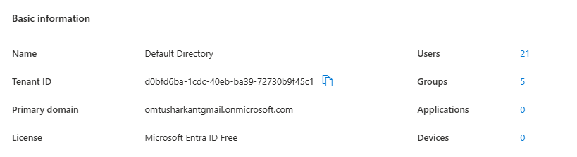
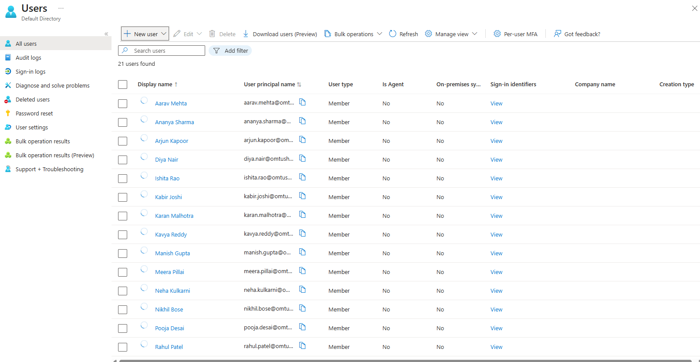
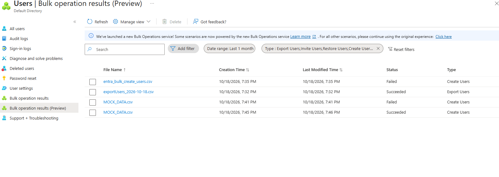
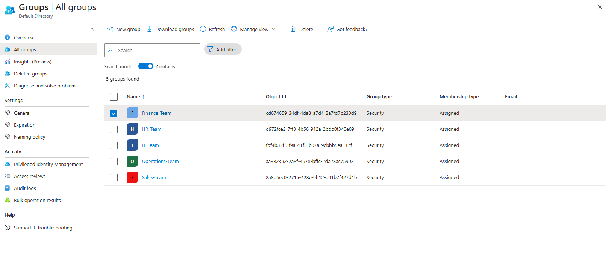
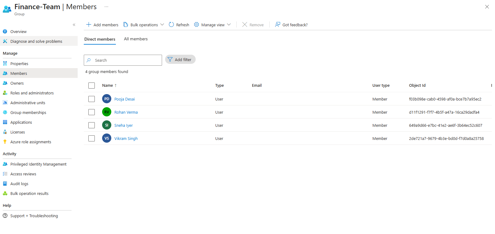
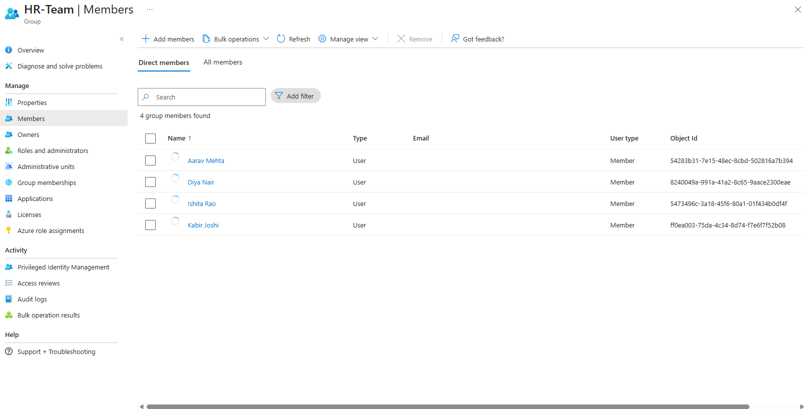
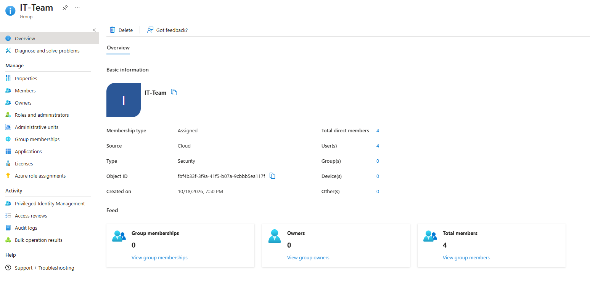
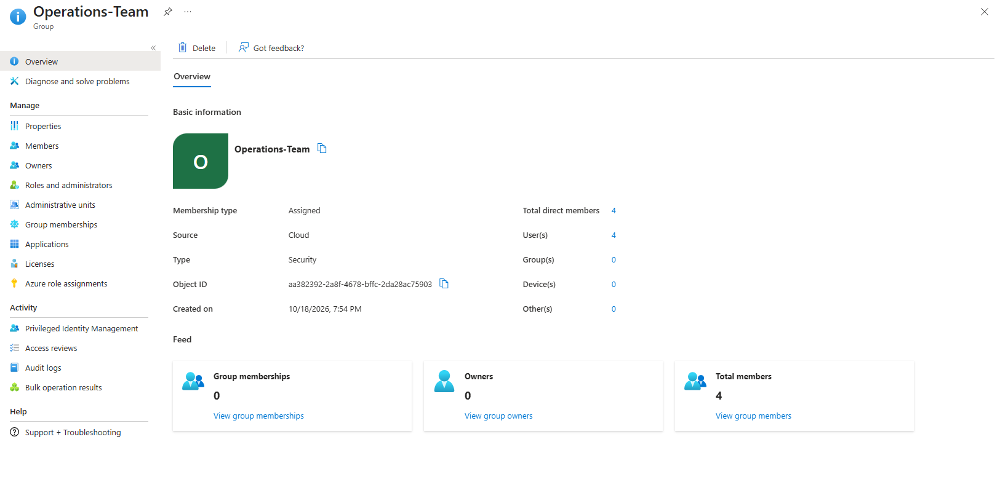
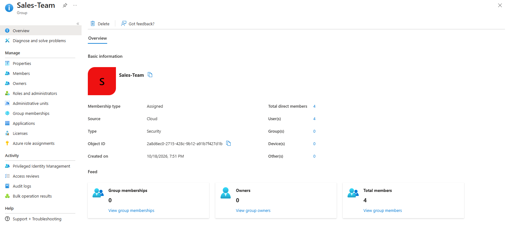

# Entra ID Lab: Users and Groups Setup

A small Microsoft Entra ID lab where I set up a test company with 20 users and 5 department groups. This is the base for my later IAM projects (user lifecycle automation, SSO + MFA, access review report).

## The problem

To practise identity and access management (IAM), I needed a safe test environment with realistic users and groups. I did not want to use real accounts or anyone's real data.

## What I built

- A free Microsoft Entra ID tenant (Entra ID Free license) in my own Azure account.
- 20 fake users, created in one go with a bulk CSV upload.
- 5 security groups, one per department, each with 4 members.

| Group | Department | Members |
|---|---|---|
| HR-Team | HR | 4 |
| Finance-Team | Finance | 4 |
| IT-Team | IT | 4 |
| Sales-Team | Sales | 4 |
| Operations-Team | Operations | 4 |

Each user has a department and a job title filled in. Later projects will use the department to decide which groups a person gets.

## Steps I followed

1. **Found my own tenant.** My login first opened a tenant belonging to another organisation (I was only a guest there). I used *Manage tenants* to switch to my own *Default Directory* tenant. I now check the tenant name in the top-right corner before making any change.
2. **Downloaded the official CSV template** from Users > Bulk operations > Bulk create.
3. **Filled it with 20 fake users** (4 per department) with a department, job title and usage location (India). Usernames use my tenant's `.onmicrosoft.com` domain.
4. **Uploaded the CSV.** The upload succeeded and the user list now shows 21 users (my 20 test users plus my own admin account).
5. **Created 5 security groups** (type: Security, membership type: Assigned) and added the 4 matching users to each.
6. **Checked the result** on each group's page: 4 direct members in every group.

## Problems I hit and how I fixed them

| Problem | Cause | Fix |
|---|---|---|
| Two bulk uploads showed "Failed" | One file did not match the official template columns, and the usernames still had a placeholder domain | Used the official template and replaced the placeholder with my real tenant domain |
| Error: "The domain portion of the userPrincipalName property is invalid. You must use one of the verified domain names in your organization." | Entra only accepts usernames that end in a domain the tenant owns | Copied the Primary domain from Entra ID > Overview and used it for every username. The next upload succeeded |
| Portal showed "You do not have access" and another organisation's name | I was looking at a tenant where I am only a guest | Switched to my own Default Directory tenant |

## What I learned

- A tenant is the organisation's identity space. Every username must end in a domain that the tenant owns.
- One login can belong to several tenants, so always check which tenant is active before creating anything.
- Bulk upload with a CSV is faster than creating users by hand, and the same approach carries over to PowerShell automation in Project 1.
- The bulk operation results page shows exactly why an upload failed.
- Assigned groups work on the free license. Dynamic groups (membership by department) need a paid license.

## Screenshots

| Step | Screenshot |
|---|---|
| Tenant overview (Entra ID Free, 21 users, 5 groups) |  |
| User list |  |
| Bulk upload history (failed attempts, then success) |  |
| All 5 groups |  |
| Finance-Team members |  |
| HR-Team members |  |
| IT-Team overview (4 members) |  |
| Operations-Team overview (4 members) |  |
| Sales-Team overview (4 members) |  |

## Next steps

- Set up Windows Server and Active Directory in VirtualBox.
- Project 1: PowerShell script that creates accounts, assigns groups by department, and handles leavers and movers.